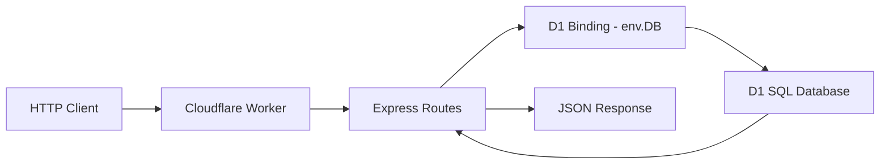

# PaaS Minggu 6 — Deploy Express + Cloudflare D1 (CRUD)

Repository ini berisi implementasi praktikum Minggu 6 mata pelajaran **Platform as a Service (PaaS)**: Lanjutan project Express.js di Cloudflare Workers dengan integrasi database relasional **Cloudflare D1 (SQLite-based)** untuk REST API CRUD persisten.

---

## 🔗 Tautan Penting
- **GitHub Repository**: [https://github.com/FirmanDN0/paas-express-worker](https://github.com/FirmanDN0/paas-express-worker)
- **Production URL**: [https://paas-express-worker.samnamrif8.workers.dev](https://paas-express-worker.samnamrif8.workers.dev)

---

## 🧠 Arsitektur: Express + Cloudflare D1



- **Runtime**: Cloudflare Workers (`@cloudflare/workers-types`, `nodejs_compat`)
- **Web Framework**: Express.js (`httpServerHandler` via `cloudflare:node`)
- **Database**: Cloudflare D1 (`paas-students-db`, binding: `env.DB`)

---

## 🚀 Endpoint REST API (CRUD)

| Method | Endpoint | SQL Query | Deskripsi | Status Code |
| :--- | :--- | :--- | :--- | :--- |
| `GET` | `/` | - | Root API status & info | `200 OK` |
| `GET` | `/api/students` | `SELECT ... ORDER BY id DESC` | Ambil seluruh daftar siswa | `200 OK` |
| `GET` | `/api/students/:id` | `SELECT ... WHERE id = ?` | Ambil data siswa berdasarkan ID | `200 OK` / `404 Not Found` |
| `POST` | `/api/students` | `INSERT INTO students ...` | Buat data siswa baru | `201 Created` / `400 Bad Request` |
| `PUT` | `/api/students/:id` | `UPDATE students SET ... WHERE id = ?` | Perbarui data siswa berdasarkan ID | `200 OK` / `404 Not Found` |
| `DELETE` | `/api/students/:id` | `DELETE FROM students WHERE id = ?` | Hapus data siswa berdasarkan ID | `200 OK` / `404 Not Found` |

---

## 🗄️ Database & Migrations

### Skema Tabel (`migrations/0001_create_students.sql`)
```sql
CREATE TABLE IF NOT EXISTS students (
  id INTEGER PRIMARY KEY AUTOINCREMENT,
  name TEXT NOT NULL,
  class_name TEXT NOT NULL,
  created_at TEXT NOT NULL DEFAULT CURRENT_TIMESTAMP
);
```

### Binding D1 di `wrangler.jsonc`
```json
{
  "$schema": "./node_modules/wrangler/config-schema.json",
  "name": "paas-express-worker",
  "main": "src/index.ts",
  "compatibility_date": "2026-10-06",
  "compatibility_flags": [
    "nodejs_compat"
  ],
  "d1_databases": [
    {
      "binding": "DB",
      "database_name": "paas-students-db",
      "database_id": "3daddbd8-e033-40f5-b6cb-8aa8e1b1b8b7"
    }
  ]
}
```

---

## 🛠️ Panduan Pengujian CRUD

### 1. Pengujian Lokal (`wrangler dev`)

```bash
# Jalankan migrasi lokal
npx wrangler d1 migrations apply paas-students-db --local

# Jalankan server lokal
npm run dev
```

### 2. Pengujian Production (`workers.dev`)

```bash
# Terapkan migrasi ke D1 remote
npx wrangler d1 migrations apply paas-students-db --remote

# Deploy worker ke Cloudflare
npm run deploy
```

#### Contoh Perintah cURL:

1. **CREATE (POST)**:
```bash
curl -X POST https://paas-express-worker.samnamrif8.workers.dev/api/students \
  -H "Content-Type: application/json" \
  -d '{"name":"Siswa Demo A","class_name":"XII SIJA 2"}'
```

2. **READ ALL (GET)**:
```bash
curl https://paas-express-worker.samnamrif8.workers.dev/api/students
```

3. **READ ONE (GET)**:
```bash
curl https://paas-express-worker.samnamrif8.workers.dev/api/students/1
```

4. **UPDATE (PUT)**:
```bash
curl -X PUT https://paas-express-worker.samnamrif8.workers.dev/api/students/1 \
  -H "Content-Type: application/json" \
  -d '{"name":"Siswa Demo B","class_name":"XII SIJA 2"}'
```

5. **DELETE**:
```bash
curl -X DELETE https://paas-express-worker.samnamrif8.workers.dev/api/students/1
```

---

## 💭 Jawaban Refleksi Modul Minggu 6

1. **Apa perbedaan data dalam variabel JavaScript dan dalam D1?**
   - Variabel JavaScript disimpan dalam memori RAM (in-memory) isolate Worker yang bersifat sementara (*ephemeral/stateless*). Jika Worker idle, cold restart, atau berpindah lokasi edge, data variabel akan hilang.
   - Cloudflare D1 menyimpan data secara persisten dan terdistribusi di database relasional SQL (SQLite-based), sehingga data tetap utuh meskipun Worker berhenti atau berganti instance.

2. **Apa fungsi binding DB dan `env.DB`?**
   - Binding DB menghubungkan konfigurasi database di Cloudflare ke kode Worker tanpa perlu memasukkan kredensial / password database secara manual.
   - `env.DB` adalah objek API runtime yang disediakan oleh Cloudflare Workers untuk menjalankan prepared statements, query, migrasi, dan transaksi SQL langsung ke database D1.

3. **Mengapa prepared SQL menggunakan `bind()`?**
   - Menggunakan `bind()` mencegah kerentanan **SQL Injection** dengan memisahkan struktur query SQL dari data input pengguna.
   - Memastikan tipe data dikonversi secara aman oleh database driver dan mengoptimalkan performa query parsing.

4. **Apa perbedaan D1 lokal dan remote?**
   - **D1 lokal**: Menggunakan file SQLite yang disimpan secara lokal di mesin pengembang (`.wrangler/state/v3/d1`) untuk keperluan testing cepat tanpa koneksi internet.
   - **D1 remote**: Database D1 sesungguhnya yang berjalan di infrastruktur Cloudflare Edge global dan diakses oleh Worker production di `*.workers.dev`.

5. **Mengapa migration remote harus dilakukan sebelum uji CRUD live?**
   - Karena D1 lokal dan D1 remote adalah dua database yang sepenuhnya terpisah. Jika skema tabel belum dimigrasikan ke remote, aplikasi Worker production akan mengalami error `no such table: students` saat memproses query SQL.

6. **Apa perbedaan metode GET, POST, PUT, DELETE?**
   - `GET`: Mengambil/membaca data dari server tanpa mengubah state database (Idempoten & Safe).
   - `POST`: Menambahkan data record baru ke dalam database.
   - `PUT`: Memperbarui seluruh field record yang sudah ada berdasarkan identifier (Idempoten).
   - `DELETE`: Menghapus data record dari database berdasarkan identifier (Idempoten).

7. **Error apa yang muncul dan bagaimana membaca log untuk menyelesaikannya?**
   - **No such table**: Ditangani dengan menjalankan `wrangler d1 migrations apply --remote`.
   - **env.DB undefined**: Ditangani dengan menyelaraskan nama binding di `wrangler.jsonc` (`binding: "DB"`).
   - **Observabilitas**: Log error dapat dipantau langsung secara realtime menggunakan `npx wrangler tail` untuk melihat stack trace dan HTTP status code request.
