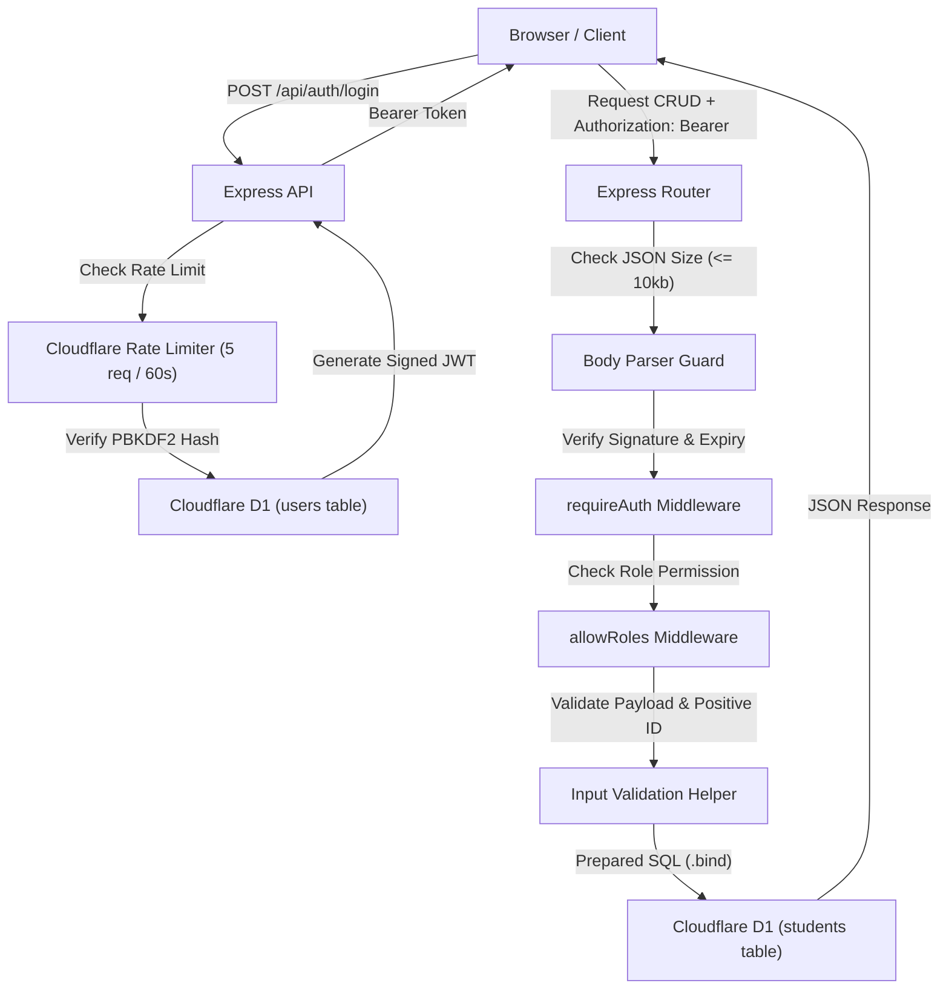

# PaaS Minggu 8 — Validasi Lanjutan & Keamanan API

Repository ini berisi implementasi praktikum Minggu 8 mata pelajaran **Platform as a Service (PaaS)**: Pengamanan menyeluruh terhadap aplikasi Fullstack Student Management Dashboard di Cloudflare Workers + D1 Database dengan menerapkan **Input Validation, Body Parsing Limits, PBKDF2 Password Hashing, JWT Authentication, Role-Based Access Control (RBAC), Workers Secrets, dan Rate Limiting**.

---

## 🔗 Tautan Penting
- **GitHub Repository**: [https://github.com/FirmanDN0/paas-express-worker](https://github.com/FirmanDN0/paas-express-worker)
- **Active Branch**: `week-8-api-security`
- **Live Production URL**: [https://paas-express-worker.samnamrif8.workers.dev](https://paas-express-worker.samnamrif8.workers.dev)

---

## 🧠 1. Arsitektur Keamanan API

---

## 👥 2. Akun Demo & Hak Akses (RBAC Matrix)

Kredensial akun demo fiktif untuk keperluan praktikum:

| Role | Email | Password Demo | GET (Read) | POST (Create) | PUT (Update) | DELETE (Remove) |
| :--- | :--- | :--- | :---: | :---: | :---: | :---: |
| **Viewer** | `viewer@paas.local` | `DwMoC_Plu0JiYm8Q` | ✅ `200` | ❌ `403` | ❌ `403` | ❌ `403` |
| **Editor** | `editor@paas.local` | `uZswq-0UAHMJgfU6` | ✅ `200` | ✅ `201` | ✅ `200` | ❌ `403` |
| **Admin** | `admin@paas.local` | `MuqFCab5dddHOolw` | ✅ `200` | ✅ `201` | ✅ `200` | ✅ `200` |

---

## 🛡️ 3. Kontrol Keamanan yang Diterapkan

1. **Batas Ukuran JSON Request**:
   - `express.json({ limit: "10kb" })` mencegah serangan Denial of Service (DoS) melalui pengiriman payload berukuran raksasa (merespons `413 Payload Too Large`).
2. **Validasi Input Ketat**:
   - `name`: String wajib, dipangkas (`trim`), panjang 2–80 karakter.
   - `class_name`: String wajib, dipangkas (`trim`), panjang 2–30 karakter.
   - `id`: Bilangan bulat positif aman (`^[1-9][0-9]*$`). Input tidak valid merespons `400 Bad Request`.
3. **Database Parameter Binding**:
   - Seluruh query ke Cloudflare D1 menggunakan `prepare("...").bind(...)` untuk mengeliminasi celah **SQL Injection**.
4. **Pencegahan XSS di Frontend**:
   - Data dirender murni menggunakan DOM API (`textContent`, `createElement`) tanpa menyisipkan string pengguna ke `innerHTML`.
5. **Penyimpanan Password Aman**:
   - Password di-hash menggunakan algoritma **PBKDF2-SHA256** dengan salt acak 16 byte per akun. Password plaintext tidak pernah disimpan di database.
6. **JWT Authentication & Expiry**:
   - Menggunakan library `jose` dengan algoritma `HS256`, masa kedaluwarsa singkat (15 menit), ditandatangani menggunakan `JWT_SECRET`.
7. **Workers Secrets**:
   - Secret signing key disimpan di Cloudflare Workers Secrets (`wrangler secret put JWT_SECRET`) untuk production dan `.dev.vars` untuk development lokal. Tidak pernah di-commit ke Git.
8. **Rate Limiting**:
   - Binding `LOGIN_RATE_LIMITER` membatasi percobaan login maksimal 5 request per 60 detik per email. Upaya berulang diblokir dengan status `429 Too Many Requests`.

---

## 🧪 4. Hasil Matriks Pengujian Keamanan Live (Production)

Pengujian dilakukan langsung ke URL `https://paas-express-worker.samnamrif8.workers.dev`:

| Skenario Pengujian | Target Endpoint & Request | Status Code yang Dihasilkan | Keterangan |
| :--- | :--- | :--- | :--- |
| **Public Health Check** | `GET /api/health` | `200 OK` | Endpoint publik dapat diakses tanpa token |
| **Akses Tanpa Token** | `GET /api/students` | `401 Unauthorized` | Ditolak oleh `requireAuth` |
| **Login Password Salah** | `POST /api/auth/login` | `401 Unauthorized` | Pesan generik: "Email or password is incorrect" |
| **Viewer Akses Baca** | `GET /api/students` (Viewer Token) | `200 OK` | Data siswa berhasil dibaca |
| **Viewer Coba Tambah** | `POST /api/students` (Viewer Token) | `403 Forbidden` | Ditolak oleh `allowRoles("editor", "admin")` |
| **Viewer Coba Hapus** | `DELETE /api/students/1` (Viewer Token) | `403 Forbidden` | Ditolak oleh `allowRoles("admin")` |
| **Editor Tambah Siswa** | `POST /api/students` (Editor Token) | `201 Created` | Siswa baru berhasil ditambahkan |
| **Input Nama Terlalu Pendek** | `POST /api/students` (`name: "A"`) | `400 Bad Request` | Gagal validasi panjang karakter (min 2) |
| **Editor Coba Hapus** | `DELETE /api/students/1` (Editor Token) | `403 Forbidden` | Ditolak oleh `allowRoles("admin")` |
| **Admin Hapus Siswa** | `DELETE /api/students/4` (Admin Token) | `200 OK` | Data berhasil dihapus dari D1 |
| **Admin Hapus ID Fiktif** | `DELETE /api/students/999999` (Admin Token) | `404 Not Found` | ID tidak ditemukan di D1 |
| **ID Bukan Bilangan Bulat** | `GET /api/students/abc` (Admin Token) | `400 Bad Request` | Gagal regex integer positif |
| **Brute-Force Login** | 8x request ke `POST /api/auth/login` | `429 Too Many Requests` | Terblokir otomatis pada percobaan ke-7 & ke-8 |

---

## 💭 5. Jawaban Refleksi Modul Minggu 8

1. **Mengapa validasi frontend saja tidak cukup?**
   - Validasi di browser hanya berfungsi untuk mempermudah pengalaman pengguna (*User Experience*). Penyerang dapat dengan mudah mem-bypass validasi frontend menggunakan `curl`, Postman, atau script otomatis tanpa melewati form HTML. Oleh karena itu, backend wajib memvalidasi setiap data yang diterima sebelum diproses ke database.
2. **Apa perbedaan authentication dan authorization?**
   - **Authentication**: Memastikan *siapa* penggunanya (proses pembuktian identitas, misalnya verifikasi email dan password untuk menerbitkan token).
   - **Authorization**: Menentukan *apa* hak akses yang dimiliki oleh pengguna tersebut (misalnya apakah role `viewer` boleh melakukan `DELETE` data).
3. **Mengapa tombol Delete yang disembunyikan tidak melindungi endpoint DELETE?**
   - Menyembunyikan elemen HTML hanya memodifikasi tampilan visual di browser. Siapa saja dapat membuka DevTools Console atau mengirim HTTP request langsung menggunakan `fetch()` atau `curl` ke endpoint `DELETE /api/students/:id`. Pengamanan sejati harus ditegakkan di server melalui middleware `allowRoles("admin")`.
4. **Mengapa password harus di-hash dan secret disimpan di backend?**
   - Jika database bocor, password yang di-hash (dengan salt) tidak dapat dibaca secara langsung oleh pihak luar. Secret (seperti `JWT_SECRET`) harus disimpan di backend agar token tidak dapat dipalsukan atau dimanipulasi oleh pihak yang tidak bertanggung jawab.
5. **Mengapa backend harus memverifikasi tanda tangan dan expiry token?**
   - Jika tanda tangan (*signature*) tidak diverifikasi, penyerang dapat memodifikasi payload token (misal mengubah role dari `viewer` menjadi `admin`). Jika masa kedaluwarsa (*expiry*) tidak diperiksa, token yang pernah dicuri dapat disalahgunakan selamanya.
6. **Apa perbedaan respons 401 dan 403?**
   - `401 Unauthorized`: Klien belum terautentikasi (belum login, token tidak ada, rusak, atau kedaluwarsa).
   - `403 Forbidden`: Klien sudah terautentikasi dan identitasnya valid, namun tidak memiliki hak akses (*permission*) untuk menjalankan operasi tersebut.
7. **Apa fungsi rate limiting dan mengapa rate limit Worker bukan penghitung global yang ketat?**
   - Rate limiting membatasi frekuensi request dalam jangka waktu tertentu untuk mencegah serangan *brute force* dan *credential stuffing*.
   - Pada Cloudflare Workers, rate limit bersifat *per-location (edge colo)* dan counter diperbarui secara asynchronous demi mempertahankan latensi ultra-rendah di seluruh dunia.
8. **Kontrol keamanan apa yang masih diperlukan sebelum aplikasi digunakan dengan data sungguhan?**
   - Menggunakan Identity Provider terpercaya atau password hashing industri (Argon2id/Bcrypt), mekanisme refresh token & pencabutan sesi (revocation), verifikasi email pengguna, CSRF protection jika memakai cookie, audit logging menyeluruh, dan monitoring ancaman otomatis (WAF).
