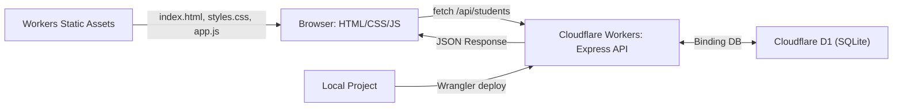

# PaaS Minggu 7 — Integrasi Frontend + Express + Cloudflare D1 (Fullstack CRUD)

Repository ini berisi implementasi praktikum Minggu 7 mata pelajaran **Platform as a Service (PaaS)**: Integrasi antarmuka pengguna frontend (HTML, CSS, JavaScript) dengan backend REST API Express.js dan database relasional Cloudflare D1 dalam satu Cloudflare Worker yang sama memanfaatkan fitur **Workers Static Assets**.

---

## 🔗 Tautan Penting
- **GitHub Repository**: [https://github.com/FirmanDN0/paas-express-worker](https://github.com/FirmanDN0/paas-express-worker)
- **Live Production URL**: [https://paas-express-worker.samnamrif8.workers.dev](https://paas-express-worker.samnamrif8.workers.dev)

---

## 🧠 1. Konsep & Arsitektur



- **Satu Origin (Same-Origin)**: Frontend disajikan langsung dari Cloudflare Static Assets di root URL (`/`), sedangkan API Express disajikan di `/api/*`. Tidak memerlukan konfigurasi CORS lintas-origin.
- **Routing Priority**: Menggunakan konfigurasi `run_worker_first: ["/api/*"]`, sehingga seluruh request ke `/api/*` diteruskan ke Worker Express + D1, sementara file aset statis (`/`, `/styles.css`, `/app.js`) disajikan secara instan via CDN Cloudflare.
- **Keamanan DOM**: Menggunakan `textContent` dan DOM API (`createElement`, `replaceChildren`) untuk mencegah celah keamanan Cross-Site Scripting (XSS).

---

## 🧱 2. Struktur Project

```
paas-express-worker/
├── public/
│   ├── index.html        # Antarmuka dashboard siswa (Form + Tabel)
│   ├── styles.css        # Tata letak & styling responsif
│   └── app.js            # Interaksi Fetch API, DOM rendering, & event listeners
├── src/
│   └── index.ts          # Backend Express + D1 Prepared SQL Queries (CRUD)
├── migrations/
│   └── 0001_create_students.sql  # Skema tabel database D1
├── wrangler.jsonc        # Konfigurasi Worker, Static Assets, & Binding D1
├── package.json
└── tsconfig.json
```

---

## ⚙️ 3. Konfigurasi Workers Static Assets (`wrangler.jsonc`)

```jsonc
{
  "$schema": "./node_modules/wrangler/config-schema.json",
  "name": "paas-express-worker",
  "main": "src/index.ts",
  "compatibility_date": "2026-10-06",
  "compatibility_flags": [
    "nodejs_compat"
  ],
  "assets": {
    "directory": "./public",
    "run_worker_first": ["/api/*"]
  },
  "d1_databases": [
    {
      "binding": "DB",
      "database_name": "paas-students-db",
      "database_id": "3daddbd8-e033-40f5-b6cb-8aa8e1b1b8b7"
    }
  ]
}
```

---

## 🚀 4. REST API Endpoint (CRUD)

| Method | Endpoint | Fungsi | Handler |
| :--- | :--- | :--- | :--- |
| `GET` | `/` | Menampilkan dashboard Student Management | Workers Static Assets (`public/index.html`) |
| `GET` | `/api/students` | Mengambil seluruh daftar siswa (JSON) | Express + D1 (`SELECT ... ORDER BY id DESC`) |
| `GET` | `/api/students/:id` | Mengambil detail siswa berdasarkan ID | Express + D1 (`SELECT ... WHERE id = ?`) |
| `POST` | `/api/students` | Menambahkan data siswa baru | Express + D1 (`INSERT INTO students ...`) |
| `PUT` | `/api/students/:id` | Memperbarui data siswa berdasarkan ID | Express + D1 (`UPDATE students SET ... WHERE id = ?`) |
| `DELETE` | `/api/students/:id` | Menghapus data siswa berdasarkan ID | Express + D1 (`DELETE FROM students WHERE id = ?`) |

---

## 🧪 5. Panduan Pengujian & Deployment

### Menjalankan Development Server Lokal
```bash
npm run dev
```
Buka browser di [http://localhost:8787](http://localhost:8787).

### Deploy ke Cloudflare Workers
```bash
npm run deploy
```
Akses URL publik: `https://paas-express-worker.samnamrif8.workers.dev/`

---

## 💭 6. Jawaban Refleksi Modul Minggu 7

1. **Mengapa frontend tidak boleh langsung membaca D1?**
   - Cloudflare D1 adalah database backend yang tidak mengekspos port atau kredensial langsung ke internet publik.
   - Jika browser langsung menghubungi database, kredensial dan hak akses database akan bocor ke klien, sehingga siapa saja dapat memanipulasi, mencuri, atau menghapus seluruh isi database tanpa validasi atau kontrol bisnis.
   - Backend Express bertindak sebagai perantara yang aman (gatekeeper) untuk memvalidasi input, menjalankan otorisasi, dan mengeksekusi parameterized query.

2. **Apa fungsi `fetch()` dan apa beda request vs JSON response?**
   - `fetch()` adalah API bawaan browser JavaScript untuk melakukan komunikasi asynchronous HTTP ke server secara terprogram tanpa memuat ulang (reload) halaman.
   - **Request**: Pesan yang dikirim dari browser ke server, berisi method (GET, POST, PUT, DELETE), header (seperti `Content-Type: application/json`), URL path, dan payload body JSON (pada POST/PUT).
   - **JSON Response**: Pesan balasan dari server ke browser yang berisi status code HTTP (misal: 200, 201, 404, 500) dan payload data dalam format teks JSON yang kemudian diparsing dengan `.json()` menjadi objek JavaScript.

3. **Mengapa browser dan API memakai URL asal yang sama (Same-Origin)?**
   - Karena frontend dan backend disajikan di domain yang sama (`https://paas-express-worker.samnamrif8.workers.dev`), browser tidak terhalang oleh kebijakan keamanan lintas-domain (Same-Origin Policy).
   - Ini menyederhanakan komunikasi: pemanggilan `fetch("/api/students")` cukup menggunakan path relatif tanpa perlu URL absolut, tanpa perlu preflight `OPTIONS` request, dan bebas dari isu CORS (*Cross-Origin Resource Sharing*).

4. **Kenapa data tetap ada setelah halaman di-refresh?**
   - Data siswa disimpan di database relasional persisten **Cloudflare D1** pada jaringan edge global, bukan di variabel lokal memori browser.
   - Setiap kali halaman dibuka atau di-refresh, skrip `app.js` mengeksekusi `loadStudents()` yang melakukan `fetch("/api/students")` untuk mengambil data terbaru langsung dari database D1.

5. **Apa beda localhost D1 dan D1 remote?**
   - **Localhost D1**: Database lokal tiruan (berkas SQLite di direktori `.wrangler/state/v3/d1`) yang hanya ada di laptop/komputer pengembang untuk pengujian cepat secara offline.
   - **D1 Remote**: Database produksi sebenarnya yang di-host di data center Cloudflare global dan diakses oleh Worker live di internet.

6. **Mengapa `textContent` lebih aman daripada menaruh data pengguna langsung ke `innerHTML`?**
   - `innerHTML` menginstruksikan browser untuk mem-parsing input string sebagai kode HTML. Jika data input berisi tag berbahaya seperti `` atau skrip jahat, kode tersebut akan dieksekusi oleh browser (celah keamanan **Cross-Site Scripting / XSS**).
   - `textContent` selalu memperlakukan input secara murni sebagai teks biasa (*plain text*), sehingga karakter HTML seperti `<`, `>`, dan `&` tidak dieksekusi sebagai tag browser.

7. **Error apa yang ditemukan dan bagaimana cara mengujinya lewat Network/Logs?**
   - Error seperti 400 (Bad Request) atau 404 (Not Found) dapat diinspeksi melalui tab **DevTools Browser → Network**:
     - Memeriksa **Headers**: Request URL, Request Method, dan Status Code.
     - Memeriksa **Payload**: Format JSON yang dikirim apakah sesuai (`name`, `class_name`).
     - Memeriksa **Response**: Pesan error JSON yang dikembalikan dari backend (`{ "error": "..." }`).
   - Di sisi server, kita dapat menjalankan `npx wrangler tail` untuk melihat streaming log dan pesan error yang dicetak oleh `console.error` di Cloudflare Workers.
